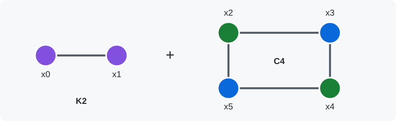

# Exact Five-Gate Boolean Circuit Complexity of C4 Disjoint Union K2

**A self-contained proof note, reproducible finite check, and unverified Lean 4 draft for L-meta-765.**

[中文说明](README.zh-CN.md) · [Full proof](docs/PROOF.md) · [Recorded result](results/finite-check.json) · [Citation](CITATION.cff)

The Boolean edge function of a four-cycle and a separate edge has minimum circuit size **five**, even when NOT gates and shared subcircuits are allowed. Gates have fan-in at most two; primary inputs and wires are not counted.

$$f=(x_0\land x_1)\lor(x_2\land x_3)\lor(x_3\land x_4)\lor(x_4\land x_5)\lor(x_5\land x_2).$$

An optimal read-once formula is

$$f=(x_0\land x_1)\lor((x_2\lor x_4)\land(x_3\lor x_5)).$$

It uses five gates. All six variables are essential; the standard support bound requires at least six minus one gates. The [proof note](docs/PROOF.md) gives both bounds, including a direct graph-counting proof, independently of Lean and upstream acceptance.

## Evidence and scope

| Item | Status |
| --- | --- |
| Elementary mathematical argument | Written in full in the proof note |
| Five-gate circuit | Correct on all 64 assignments |
| Essential variables | Six explicit dependence witnesses, all checked |
| Lean formalization | **Unverified draft**; local build stopped during dependency compilation |
| Official submission / acceptance | Not submitted / not accepted |

This repository supplies a reproducible worked example and a formalization candidate for this particular graph. The general support bound and upstream definitions are existing work. Historical priority for this elementary special case has not been established. No new general lower bound or solution to P versus NP is claimed.

## Reproduce

Python 3 with its standard library is sufficient:

    git clone https://github.com/lichenglicheng0057-dotcom/p-vs-np-small-proofs.git
    cd p-vs-np-small-proofs
    python scripts/verify_cycle4_edge.py

Expected results: gate_count = 5, truth_table_rows = 64, mismatch_count = 0, and all_six_inputs_essential = true. The program exits nonzero if the construction or a dependence witness fails. Compare [results/finite-check.json](results/finite-check.json).

The computation checks the construction and witnesses. It does not enumerate all circuits or verify Lean proofs; the universal lower bound is supplied by the mathematical argument.

## Files

| File | Purpose |
| --- | --- |
| [docs/PROOF.md](docs/PROOF.md) | Precise model, theorem, gate table, lower-bound proof and sources |
| [proofs/L_meta_765.lean](proofs/L_meta_765.lean) | Unverified Lean draft preserving the posted statement |
| [scripts/verify_cycle4_edge.py](scripts/verify_cycle4_edge.py) | Exhaustive construction check and six witnesses |
| [results/finite-check.json](results/finite-check.json) | Reproducible reference output |
| [CITATION.cff](CITATION.cff) | GitHub citation metadata |

## Citation

Use GitHub's **Cite this repository** entry, or cite:

> 郝东春 (lichenglicheng0057-dotcom). 2026. *Exact Five-Gate Boolean Circuit Complexity of C4 Disjoint Union K2: Proof Note and Verification Code*. GitHub. https://github.com/lichenglicheng0057-dotcom/p-vs-np-small-proofs

    @misc{hao2026c4k2,
      author = {{郝东春}},
      title = {Exact Five-Gate Boolean Circuit Complexity of C4 Disjoint Union K2: Proof Note and Verification Code},
      year = {2026},
      howpublished = {GitHub research note and code},
      url = {https://github.com/lichenglicheng0057-dotcom/p-vs-np-small-proofs},
      note = {Lean formalization unverified; cite the commit used}
    }

Include a commit hash or an immutable GitHub commit permalink for reproducibility. This identifies a research note and code, not a peer-reviewed paper or officially accepted proof. No DOI has been assigned. Cite upstream sources separately for their general results and definitions.

## Sources and formal status

The public target is [L-meta-765](https://pequalnp.com/lemma#L-meta-765). Sources are pinned to upstream revision [198cfc2b632227c5113cd2afde52a74a0dd9f532](https://github.com/brilliant-hq/pequalnp-proofs/tree/198cfc2b632227c5113cd2afde52a74a0dd9f532); see the [precise source links](docs/PROOF.md#sources-and-provenance). AI assistance was used in drafting the exposition and code; this is not independent peer review.

The Lean draft targets upstream Lean 4.36.0 and Mathlib revision fc4f59e577feb1a4956671bc04ac18aaaf8cd842. It reuses the existing dep_lower theorem through the allowed L112 dependency chain. Neither a completed local formal check nor official acceptance is claimed.

This public note can be read and cited independently of upstream acceptance. A future upstream PR must separately follow the [participation instructions](https://pequalnp.com/join.txt) and [contribution rules](https://github.com/brilliant-hq/pequalnp-proofs/blob/main/CONTRIBUTING.md), including task assignment. This account has not been assigned L-meta-765.

[Apache-2.0 license](LICENSE). Search terms: Boolean edge function, circuit complexity, circuit size, fan-in two, read-once formula, C4 + K2, C4 disjoint union K2, L-meta-765, Lean 4.
