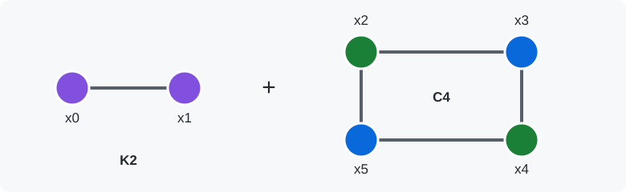

# C4 与 K2 不相交并图的精确五门布尔电路复杂度

[English](README.md) · [完整证明](docs/PROOF.md) · [有限验证结果](results/finite-check.json) · [引用信息](CITATION.cff)

这是关于**四边形加一条独立边**的布尔边函数的小型数学记录，对应公开任务 **L-meta-765**。作者：郝东春（GitHub：lichenglicheng0057-dotcom）。

六个顶点对应六个输入；某条边的两个端点都为真时，函数输出真。电路允许 AND、OR、NOT 门，每个门最多读两个输入，门数不计原始输入和连线，也允许共享中间结果。

## 结论与证明

最少门数是 **5**。构造为：

$$f=(x_0\land x_1)\lor((x_2\lor x_4)\land(x_3\lor x_5)).$$

两个 OR、两个 AND、最后一个 OR，共五门。六个变量分别都有影响输出的例子；二输入单输出电路要依赖六个输入，至少需要五门。[完整证明](docs/PROOF.md)通过依赖图的顶点数和边数证明下界，覆盖共享子电路和 NOT 门。

## 证据状态

- 完整纸面论证和具体五门电路表已写出。
- Python 逐一检查全部64种输入，输出无差异；六个变量的依赖例子全部通过。
- Lean 草稿尚未完成形式验证：本地构建在编译公共依赖时由维护者主动停止，不是收到反例或官方否定。
- 尚未提交官方 PR，也没有官方接收或审核通过的记录。

有限检查验证了具体构造和六个例子。“不能少于五门”来自数学证明，不是对所有电路的穷举。

## 复现与引用

安装 Python 3 后，在仓库目录执行：

    python scripts/verify_cycle4_edge.py

只使用标准库。预期 mismatch_count 为0、all_six_inputs_essential 为true。参考输出见 [results/finite-check.json](results/finite-check.json)。

若使用本说明、电路表或代码，可用 GitHub 侧栏 **Cite this repository**，或引用：

> 郝东春（lichenglicheng0057-dotcom），2026。《Exact Five-Gate Boolean Circuit Complexity of C4 Disjoint Union K2: Proof Note and Verification Code》。GitHub 数学说明与代码。https://github.com/lichenglicheng0057-dotcom/p-vs-np-small-proofs

建议同时记录所用提交哈希，以对应具体版本。这是公开技术记录，不是期刊论文或已获官方认可的证明。通用支撑集下界和上游定义属于已有工作，来源见[证明末尾](docs/PROOF.md#sources-and-provenance)；不声称这些一般方法或此简单特例的历史首创性。文稿和代码使用了 AI 辅助。

本记录可以独立于官方是否接收而阅读、复现和引用。后续官方投稿仍须另行满足任务领取、原命题构建和单文件提交等要求。采用 [Apache-2.0](LICENSE) 许可。
